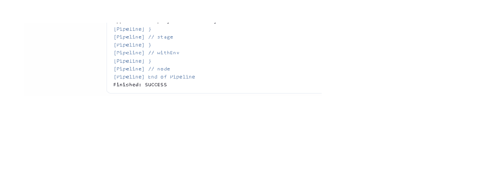

# Devops-task-2-Jenkins-CICD
Jenkins CI/CD Pipeline with Build, Test and Deploy stages
Testing Jenkins Poll SCM
## CI/CD Pipeline Stages

 **Checkout:** Pull source code from GitHub.
 **Build:** Prepare the application.
 **Test:** Execute application testing.
 **Deploy:** Deploy the application successfully.

## Jenkins Poll SCM

Configured Poll SCM to check GitHub repository changes automatically.

## Build Status

Latest Jenkins Build: SUCCESS

## Screenshot

## Tools Used

- Git
- GitHub
- Jenkins
- Groovy
- CI/CD Pipeline
